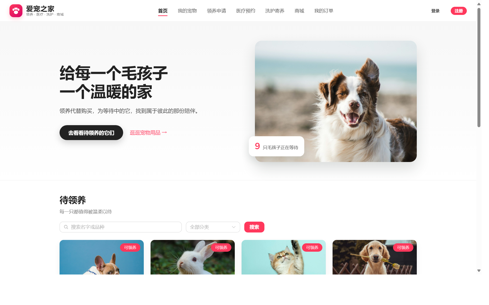
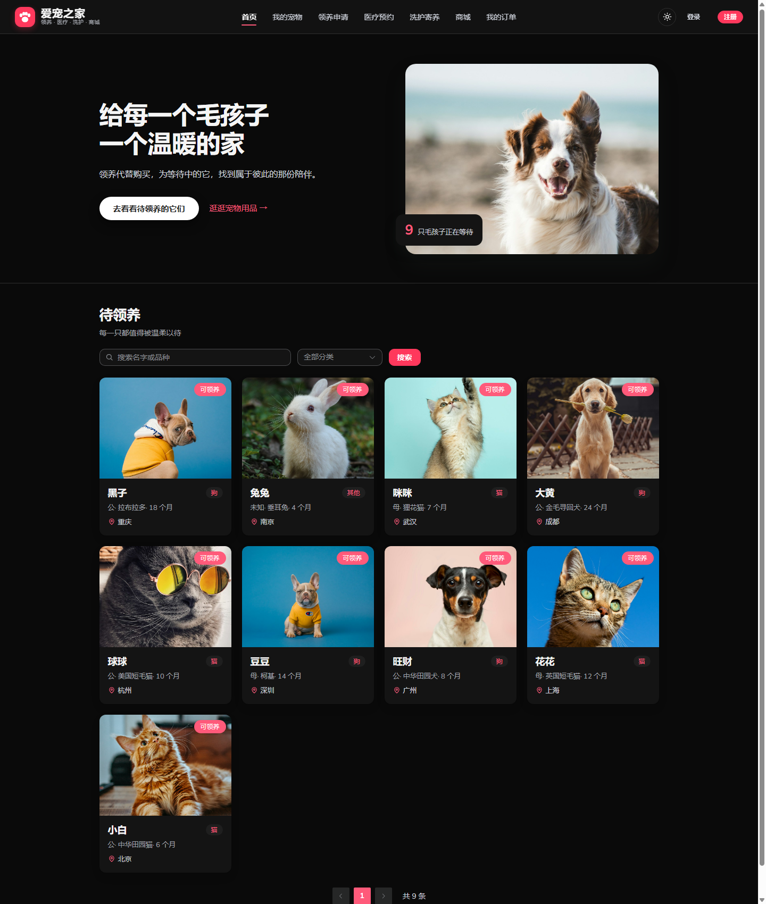
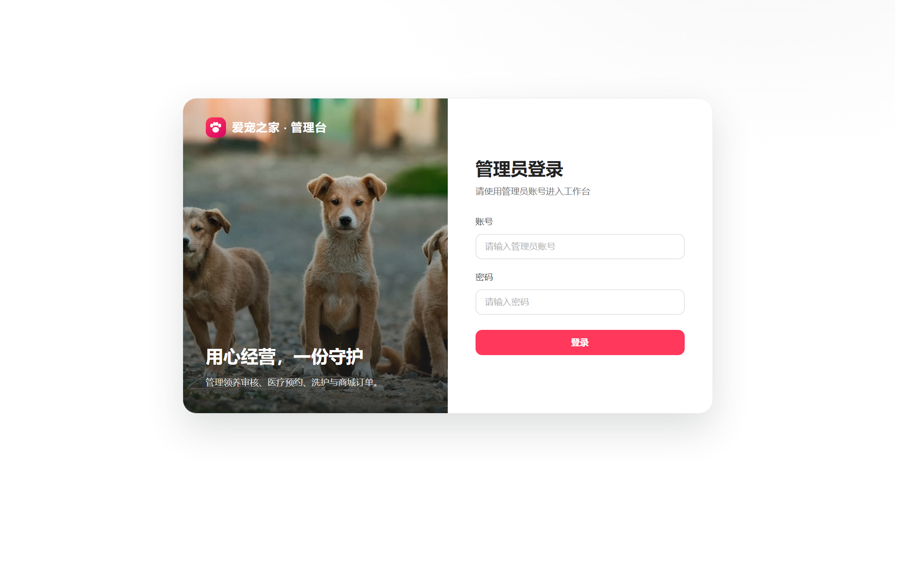

# 智能宠物综合服务平台

> 基于前后端分离架构的宠物综合服务平台，覆盖 **宠物领养 · 医疗预约 · 洗护/寄养 · 宠物用品商城** 四条核心业务线，支持 Docker 一键部署。

<p align="center">
  
  
  
  
  
  
  
  
</p>

## ✨ 界面预览

<p align="center">
  
  
  
</p>

前端采用 Airbnb 生活电商风格（珊瑚红 `#FF385C` + 墨黑 + 纯白留白），支持**明暗主题一键切换**与偏好持久化。

## 🎯 核心特性

- **四条业务线闭环**：宠物领养申请/审核、医疗预约（排班容量防超卖）、洗护/寄养预约（价格快照）、宠物用品商城（购物车/下单/发货/收货）。
- **工程化后端**：FastAPI 分层架构（`api → services → repositories → models`）、SQLAlchemy 2.x + Alembic 迁移、统一响应信封、全局异常/日志/请求 ID。
- **并发安全**：下单与排班 `SELECT FOR UPDATE` 行锁防超卖、库存流水审计、下单幂等键、事务内落通知 + 提交后 WebSocket 推送。
- **认证与权限**：JWT + bcrypt 密码哈希、角色依赖（普通用户 / 管理员）、双端独立登录与路由守卫。
- **实时提醒**：管理端 WebSocket 工作台，领养/医疗/洗护/订单四类业务实时通知 + 未读红点。
- **定时任务**：APScheduler 超时订单自动关闭并返还库存。
- **一键部署**：Docker Compose（MySQL + Redis + 后端 + Nginx 双站点）自动迁移 + 幂等 seed，生产/演示环境开箱即用。

## 🧱 技术栈

| 层 | 技术 |
|---|---|
| 后端 | Python 3.11+ · FastAPI · SQLAlchemy 2.x · Alembic · Pydantic 2 · PyMySQL · PyJWT · Passlib(bcrypt) · APScheduler |
| 数据库 | MySQL 8.0（主库） · Redis 7（缓存 / 购物车） |
| 前端 | Vue 3 · Vite · Element Plus · Pinia · Vue Router · Axios |
| 部署 | Docker Compose · Nginx（双站点反代 + WebSocket 升级） |

## 📦 功能模块

| 业务线 | 能力 |
|---|---|
| 🐾 宠物领养 | 公开列表/筛选/详情、申请/撤回、管理员审核通过/拒绝（通过后自动关闭同宠物其他待审核申请） |
| 🏥 医疗预约 | 医疗点/医生/项目/排班管理、排班容量事务防超卖、取消/拒绝释放名额、确认/完成 |
| 🛁 洗护/寄养 | 服务分类/套餐、价格快照（寄养按天计费）、日期互斥校验、预约确认/拒绝/完成 |
| 🛒 宠物商城 | 商品分类/商品、Redis 购物车、下单锁库存防超卖、库存流水、订单状态机、确认收货 |
| 🔔 工作台 | 实时统计（用户数/待审核/待处理/待发货/未读）、最近业务动态点击跳转、WebSocket 提醒 |

## 🚀 快速开始

### Docker 一键部署（推荐）

```bash
git clone https://github.com/<your-name>/pet-comprehensive-platform.git
cd pet-comprehensive-platform
cp .env.example .env          # 设置 ADMIN_SEED_PASSWORD 与 JWT_SECRET_KEY
docker compose up -d --build
```

- 用户端 `http://localhost:80` · 管理端 `http://localhost:81`
- 后端容器启动时自动 `alembic upgrade head`，非生产环境幂等 seed（管理员 + 演示数据）
- 演示管理员账号：`admin`（密码即 `.env` 中的 `ADMIN_SEED_PASSWORD`）；普通用户通过注册接口自行注册

### 本地开发

```bash
# 1. 启动基础设施（MySQL 8.0 + Redis）
docker compose up -d mysql redis

# 2. 后端
cd server
python -m venv .venv && source .venv/bin/activate   # Windows: .venv\Scripts\activate
pip install -r requirements.txt
cp ../.env.example .env
alembic upgrade head
ADMIN_SEED_PASSWORD=你的密码 python -m scripts.seed
uvicorn app.main:app --reload                        # http://localhost:8000

# 3. 前端
cd admin-web && npm install && npm run dev           # 管理端 http://localhost:5173
cd user-web  && npm install && npm run dev           # 用户端 http://localhost:5174
```

- 存活探针 `GET /health` · 就绪探针 `GET /health/ready`（校验 MySQL + Redis）
- 接口文档 `http://localhost:8000/docs`

### 运行测试

```bash
cd server
pytest            # 107 passed
```

## 🗂 目录结构

```
pet-comprehensive-platform/
├── server/            # FastAPI 后端（api / schemas / services / repositories / models / core）
│   ├── alembic/       # 数据库迁移
│   ├── scripts/       # seed 脚本（幂等，演示数据 + 图片复制）
│   ├── seed_data/     # 演示图片（随代码入库）
│   └── tests/         # pytest 用例
├── admin-web/         # 管理端（Vue 3 + Element Plus）
├── user-web/          # 用户端（Vue 3 + Element Plus）
├── deploy/            # Dockerfile（前后端）+ Nginx 配置 + 启动脚本
├── docs/              # 计划基线、API、数据库设计、部署文档、界面截图
├── docker-compose.yml # MySQL + Redis + 后端 + Nginx 一键编排
└── LICENSE
```

## 📄 文档

| 文档 | 说明 |
|---|---|
| `docs/计划初稿.md` | 项目需求基线（唯一事实来源） |
| `docs/项目计划与结构.md` | Day 1~10 开发计划与验收标准 |
| `docs/数据库设计.md` | 表结构与关系 |
| `docs/API接口说明.md` | 接口清单与响应规范 |
| `docs/开发与部署说明.md` | 本地开发 / Docker / 生产部署要点 |
| `docs/待确认事项.md` | 需求演进中的待确认项与决策记录 |

## 📝 统一响应规范

```json
{ "code": 0, "message": "success", "data": {} }
```

| 业务码 | 含义 |
|---|---|
| `0` | 成功 |
| `40001` | 参数错误 |
| `40100` | 未登录 |
| `40300` | 无权限 |
| `40400` | 资源不存在 |
| `40900` | 状态冲突 |
| `50000` | 服务异常 |

## ⚠️ 免责声明

- 本项目**支付为模拟流程**，不接入真实支付渠道，请勿用于生产收款。
- 数据库中的宠物、商品、用户等均为**演示数据**，无真实个人信息。
- 生产部署请务必更换 `JWT_SECRET_KEY`、数据库密码，并启用 HTTPS/WSS（见 `docs/开发与部署说明.md`）。

## 📄 License

[MIT](LICENSE) © 2026 lkuko
